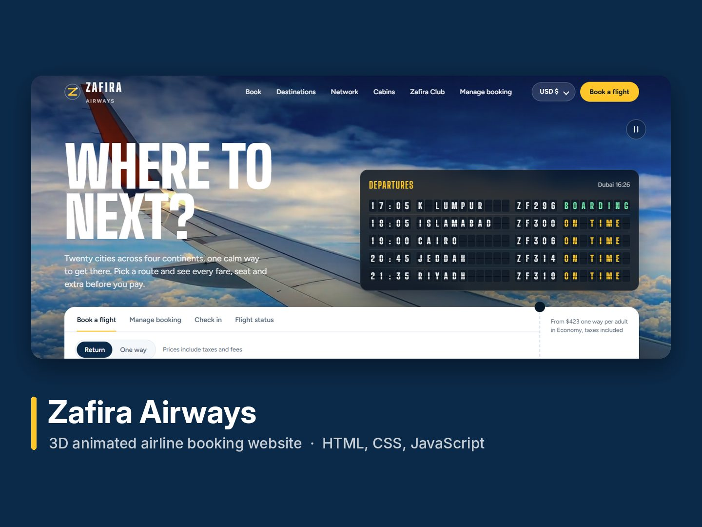
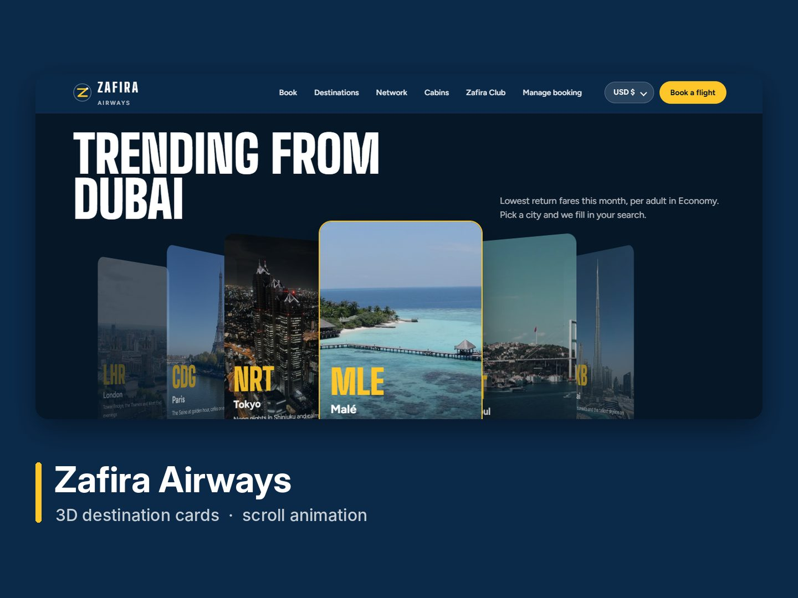
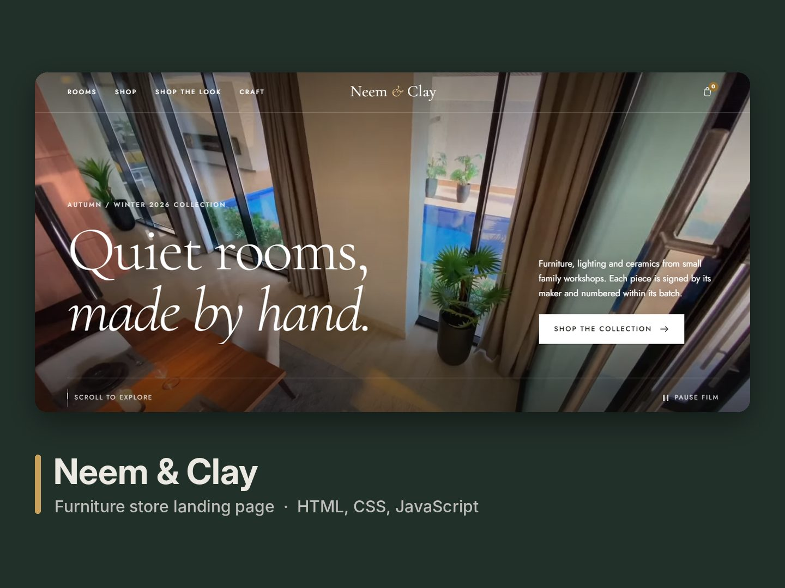
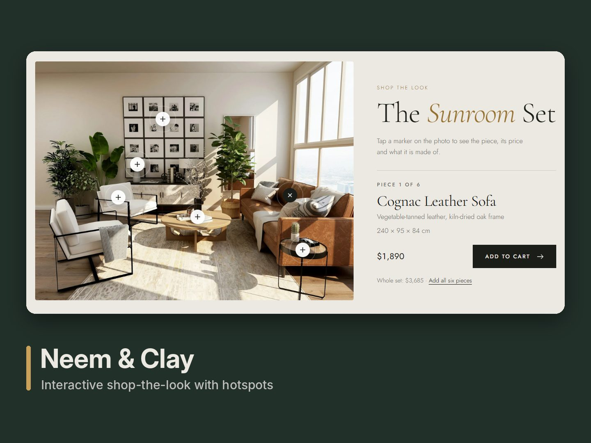
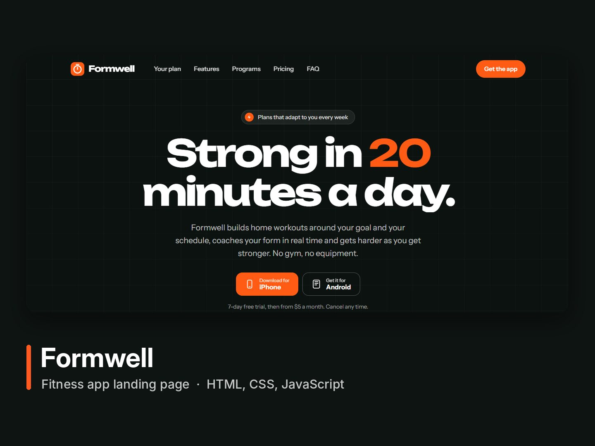
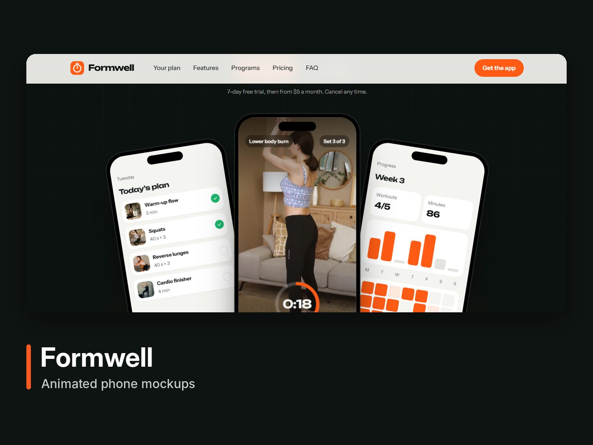
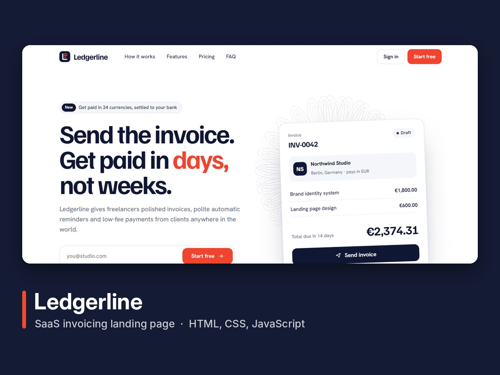
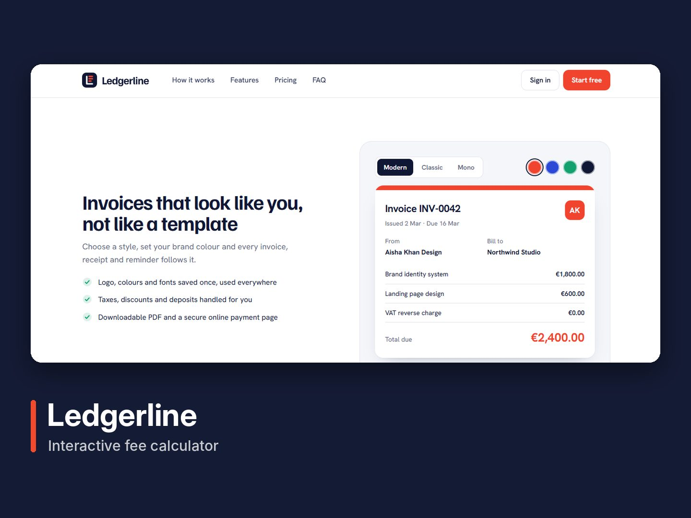

# Web Portfolio – Landing Pages & 3D Animated Websites

Concept websites built with **HTML, CSS and JavaScript** to show front-end design and development work: responsive landing pages, scroll animations, video heroes and 3D effects.

All brands below are fictional. Photos and videos are free stock media from Pexels.

| Project | Type | Live demo |
|---|---|---|
| Zafira Airways | 3D animated airline booking website | [zafira-airways-demo.netlify.app](https://zafira-airways-demo.netlify.app) |
| Neem & Clay | Furniture store landing page | [neem-and-clay-demo.netlify.app](https://neem-and-clay-demo.netlify.app) |
| Formwell | Fitness app landing page | [formwell-fitness-demo.netlify.app](https://formwell-fitness-demo.netlify.app) |
| Ledgerline | SaaS invoicing landing page | [ledgerline-invoicing-demo.netlify.app](https://ledgerline-invoicing-demo.netlify.app) |

---

## Zafira Airways

3D animated airline website with a split-flap departures board, video hero, 3D destination carousel, scroll-driven video reveal, cabin comparison, membership card and a full booking flow with seat selection and boarding pass.




**Live:** https://zafira-airways-demo.netlify.app · **Code:** [`zafira-airways/`](zafira-airways/)

## Neem & Clay

Furniture store landing page with a video hero, shop-by-room cards, product slider with filters, a shop-the-look photo with clickable hotspots, a horizontal-scroll lookbook, cart drawer and contact form. Light and dark mode.




**Live:** https://neem-and-clay-demo.netlify.app · **Code:** [`neem-and-clay/`](neem-and-clay/)

## Formwell

Fitness app landing page with animated phone mockups, workout videos, an interactive plan builder that updates the phone screen, a form-coach demo, programs, pricing and FAQ.




**Live:** https://formwell-fitness-demo.netlify.app · **Code:** [`formwell-fitness/`](formwell-fitness/)

## Ledgerline

SaaS invoicing landing page with a live invoice demo, a three-step "how it works" section, an invoice style switcher, an interactive fee calculator, pricing and FAQ.




**Live:** https://ledgerline-invoicing-demo.netlify.app · **Code:** [`ledgerline-invoicing/`](ledgerline-invoicing/)

---

## Run locally

Each project is a static site. Open the folder and serve it with any static server, for example:

```bash
cd zafira-airways
python3 -m http.server 8000
```

Then visit `http://localhost:8000`.

## Tech

HTML5, CSS3, JavaScript, GSAP / ScrollTrigger, Three.js, responsive design, Netlify hosting.
